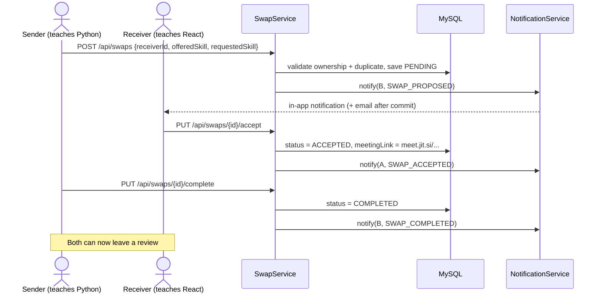
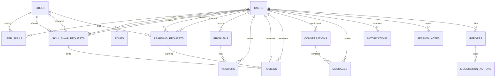

# SkillSwap — Project Guide

> **Learn. Teach. Swap. Grow.**
> A peer-to-peer skill exchange platform for students.
>
> **Stack:** Spring Boot 3.4.3 (Java 21) · React 19 + Vite 8 · MySQL 8
> **Backend:** http://localhost:9090 · **Frontend:** http://localhost:5173
> _Facts in this document were verified against the codebase and a running instance (27 Oct 2026)._

---

## Table of contents

1. [The pitch](#1-the-pitch)
2. [Problem → solution](#2-problem--solution)
3. [Feature tour](#3-feature-tour)
4. [Tech stack (and why)](#4-tech-stack-and-why)
5. [System architecture](#5-system-architecture)
6. [End-to-end request flow](#6-end-to-end-request-flow)
7. [Core business flows](#7-core-business-flows)
8. [Data model](#8-data-model)
9. [Security design](#9-security-design)
10. [Testing and evidence](#10-testing-and-evidence)
11. [Project structure](#11-project-structure)
12. [How to run it](#12-how-to-run-it)
13. [10-minute live demo script](#13-10-minute-live-demo-script)
14. [Slide-by-slide outline with speaker notes](#14-slide-by-slide-outline-with-speaker-notes)
15. [Viva / Q&A prep](#15-viva--qa-prep)
16. [Honest limitations and roadmap](#16-honest-limitations-and-roadmap)
17. [Glossary](#17-glossary)

---

## 1. The pitch

**One line:**
> SkillSwap is a platform where students trade skills instead of paying for courses — I teach you Python, you teach me React, and we meet in a built-in video room.

**30-second version:**
> Students already have skills worth teaching. What they lack is a trusted, low-friction way to find a peer who wants to learn them. SkillSwap turns that into a structured exchange: users list what they can teach and what they want to learn, the marketplace matches mutual needs, and every exchange has a full lifecycle — request, accept, meet, take shared notes, complete, review. If a direct swap isn't possible, users can ask for a free shared learning session, or ask a question in the public Q&A section. Reputation, ratings and moderation keep it trustworthy.

**Why this is a real product, not a CRUD demo:**
- It has a **domain** with rules: you cannot offer a skill you don't teach, you cannot accept your own request, you cannot review an incomplete session.
- It has a **state machine** (5 states) enforced on the server, not in the UI.
- It has **trust and safety** (reports, audit trail, suspension) and **reputation** (ratings, helpful points, leaderboard).
- It has **asynchronous side effects** (in-app notification + email after the database commit).

---

## 2. Problem → solution

| Problem for a student | SkillSwap's answer |
|---|---|
| Paid courses are expensive | Skill-for-skill exchange is free |
| "I know this, someone near me needs it" is hard to discover | Marketplace with search, categories, ratings and mutual-match detection |
| Meeting a stranger online feels unsafe | Profiles, reviews, reports, moderation queue, account suspension |
| Exchanges are unstructured and forgotten | Request lifecycle, video room, shared session notes, learning progress |
| Some skills have no swap partner | Free shared learning sessions (study the same skill together) |
| Quick doubts don't need a whole session | Public Q&A with accepted answers and reputation |

**Three ways to use the platform** (a good slide title):

1. **Swap** — trade two different skills (Python ⇄ React).
2. **Shared learning** — book a peer who knows the same skill you're studying; nothing is offered in return.
3. **Q&A** — ask a question publicly, get answers, accept the best one.

---

## 3. Feature tour

| Page / route | What the user can do | Backend module |
|---|---|---|
| `/` Home | Value proposition, categories, featured people | `skill`, `community` |
| `/register`, `/login` | Create account, choose Learn / Teach / Both | `auth`, `user` |
| `/explore` | Search teachers, filter by category/free, sort by rating, open profiles, send request | `skill`, `user`, `review` |
| `/requests` | Incoming / Outgoing / History / "To review" tabs for swaps **and** shared sessions | `swap`, `learning`, `review` |
| `/session/swap/:id`, `/session/learning/:id` | Video room (Jitsi), participants, session notes, complete session | `swap`, `learning`, `session` |
| `/messages` | Two-pane chat, unread badges, read ticks, older-message paging | `chat` |
| `/notifications` | Bell dropdown + full page, mark read / mark all | `notification` |
| `/qa` | Public Q&A feed, search, filters, ask a question | `problem` |
| `/qa/:id` | Answers, accept answer (+10 reputation), close / reopen | `problem` |
| `/profile/:userId` | Public profile: teaches, wants to learn, reviews, ratings, Q&A stats | `user`, `review` |
| `/community` | Top contributors leaderboard | `community` |
| `/dashboard` | My skills, avatar upload, learning progress, stats | `skill`, `user`, `progress` |
| `/admin/reports` | Moderation queue, target preview, dismiss / hide / suspend, audit trail | `moderation` |

**Scale of the codebase (measured):**

| Metric | Value |
|---|---|
| Backend Java files | 125 (≈ 7,800 LOC in `src/main`) |
| Frontend JS/JSX files | 48 (≈ 7,400 LOC) |
| Backend modules | 14 feature modules |
| REST endpoints | ≈ 70 |
| Automated backend tests | **74, all passing** (11 test classes) |
| Seeded skills | 32 across 7 categories |
| Seeded demo profiles | 22 |
| Seeded demo Q&A threads | 20 |

---

## 4. Tech stack (and why)

### Backend

| Technology | Version | Role in the project | Why this choice |
|---|---|---|---|
| **Java** | 21 | Language | Modern LTS: records, pattern matching, virtual-thread-ready |
| **Spring Boot** | 3.4.3 | Application framework | Auto-configuration, embedded Tomcat, production defaults |
| **Spring Web (MVC)** | — | REST controllers | Standard `@RestController` + JSON |
| **Spring Data JPA / Hibernate** | — | Persistence | Repository interfaces remove boilerplate SQL; entity mapping |
| **Spring Security** | — | Authentication + authorization | Filter chain, BCrypt, role checks, method security |
| **JJWT** | 0.12.6 | JWT creation/validation | HS256 signing, stateless auth |
| **Bean Validation** | — | Input validation | `@NotBlank`, `@Email`, `@Size` on DTOs |
| **Spring Mail** | — | Notification emails | Branded HTML + plain-text alternative |
| **MySQL** | 8.0.46 | Database | Relational fits the domain (many joins, FKs, unique constraints) |
| **H2** | test scope | Test database | Fast, isolated integration tests |
| **Maven Wrapper** | — | Build | Reproducible build without a global Maven install |
| **JUnit 5 + MockMvc** | — | Testing | Integration tests through the real filter chain |

**Why a layered, feature-module structure?**
`controller → service → repository → entity` keeps HTTP concerns out of business rules. Each feature owns its own package, so a change to moderation cannot accidentally touch swaps.

### Frontend

| Technology | Version | Role | Why |
|---|---|---|---|
| **React** | 19.2 | UI library | Component model, huge ecosystem |
| **Vite** | 8.3 | Dev server + build | Instant HMR, native ESM, tiny config |
| **React Router** | 7.18 | Client-side routing | 20 route entries, nested redirects, no full reloads |
| **Axios** | 1.20 | HTTP client | Interceptors for JWT injection and global 401 handling |
| **lucide-react** | 1.59 | Icons | Consistent icon set |
| **Plain CSS + variables** | — | Styling | Light/dark theme tokens, no build step, easy to review |
| **oxlint** | 1.81 | Linting | Fast Rust-based linting |

**Why no state library (Redux/Zustand)?**
The only truly global state is *who is logged in* and *toasts*. Both live in React Context (`AuthContext`, `ToastContext`). Everything else is page-local state fetched from the API. Adding Redux would add ceremony without removing a problem.

### Infrastructure / tooling

- **Vite proxy** (`/api` → `localhost:9090`) — the browser talks to one origin in development, so CORS never gets in the way of local work.
- **PowerShell E2E scripts** — `e2e-smoke.ps1`, `e2e-reviews.ps1`, `e2e-qa.ps1`, `e2e-messaging.ps1` exercise the live API.
- **`ui-smoke.mjs`** — drives real Chrome over the DevTools Protocol for browser-level checks.
- **`.env` + `${VAR:default}` placeholders** — secrets never hardcoded in `application.yml`.

---

## 5. System architecture

### 5.1 Three-tier view

```
┌──────────────────────────────────────────────────────────────────────┐
│  PRESENTATION TIER                                                   │
│  React 19 SPA (Vite dev server :5173)                                │
│  Pages → Components → Services (axios) → AuthContext / ToastContext  │
└───────────────────────────────┬──────────────────────────────────────┘
                                │ HTTP/JSON  (Authorization: Bearer <JWT>)
                                │ dev: Vite proxies /api → :9090
┌───────────────────────────────▼──────────────────────────────────────┐
│  APPLICATION TIER                                                    │
│  Spring Boot 3.4 (:9090)                                             │
│                                                                      │
│  Servlet filter chain                                                │
│    CORS → JwtAuthenticationFilter → Security authorization           │
│         → DispatcherServlet                                          │
│              → @RestController (HTTP + validation)                   │
│                   → @Service (business rules, @Transactional)         │
│                        → @Repository (Spring Data JPA)               │
└───────────────────────────────┬──────────────────────────────────────┘
                                │ JDBC (Hibernate)
┌───────────────────────────────▼──────────────────────────────────────┐
│  DATA TIER                                                           │
│  MySQL 8 (:3306)  —  skillswap_db                                    │
│  16 tables · FKs · unique constraints · enum columns                 │
└──────────────────────────────────────────────────────────────────────┘
```

### 5.2 Backend module map

```
com.skillswap
├── SkillSwapApplication          # @SpringBootApplication entry point
├── common/                       # ApiResponse<T>, PageResponse<T>
├── config/
│   ├── SecurityConfig            # filter chain, CORS, BCrypt, JSON 401/403
│   ├── DataInitializer           # roles, admin bootstrap, 32 skills
│   ├── DemoDataInitializer       # 22 demo profiles, 20 Q&A threads
│   ├── AsyncConfig               # bounded email executor
│   └── WebConfig                 # static /api/files/** mapping
├── exception/                    # GlobalExceptionHandler + 3 typed exceptions
├── security/                     # JwtTokenProvider, JwtAuthenticationFilter,
│                                 # CustomUserDetails(Service)
└── modules/
    ├── auth/          register, login → JWT
    ├── user/          profile, avatar storage
    ├── skill/         catalog, my-skills, marketplace, matching
    ├── swap/          skill-for-skill exchange lifecycle
    ├── learning/      free shared learning sessions
    ├── session/       shared notes for swaps + learning
    ├── progress/      learning dashboard read model
    ├── review/        ratings tied to completed sessions
    ├── problem/       Q&A, answers, reputation
    ├── chat/          1:1 conversations and messages
    ├── notification/  in-app notifications + async email
    ├── community/     leaderboard
    ├── moderation/    reports, queue, audit, suspension
    └── system/        health endpoint
```

**Pattern used inside every module:** `controller` (HTTP) → `service` (rules + transaction) → `repository` (query) → `entity` (table), with `dto` objects at the boundary. Entities never leave the backend — that is why `UserResponse` and `PublicUserResponse` exist.

### 5.3 Frontend structure

```
frontend/src
├── main.jsx                 # React root
├── App.jsx                  # Router + providers + footer
├── index.css                # design tokens, light/dark theme
├── context/
│   ├── AuthContext.jsx      # user, login, register, logout, boot restore
│   └── ToastContext.jsx     # transient success/error messages
├── services/                # 14 thin API modules, one per backend area
│   ├── apiClient.js         # axios instance + interceptors + assetUrl()
│   └── authService.js …     # one function per endpoint
├── components/
│   ├── layout/              # Navbar, NotificationBell
│   ├── ui/                  # Avatar, Modal
│   ├── swap/                # RequestModal, SwapCard, StatusBadge
│   ├── learning/            # LearningCard
│   ├── session/             # SessionNotesPanel
│   ├── review/              # RatingStars, ReviewModal
│   ├── problem/             # AskQuestionModal
│   └── moderation/          # ReportButton, ReportModal
└── pages/                   # 14 page components (20 route entries)
```

**Rule of thumb used:** pages own data fetching and layout; components are presentational and reusable; services know URLs and nothing else.

---

## 6. End-to-end request flow

### 6.1 "What happens when I click a button?"

Example: **the user clicks "Send request"** on a profile.

```
 1. UI event            RequestModal validates locally, calls swapService.create(...)
 2. Service             axios.post('/swaps', payload)
 3. Request interceptor reads localStorage token
                        → adds  Authorization: Bearer eyJhbGciOi...
 4. Network             POST http://localhost:5173/api/swaps
 5. Vite proxy          forwards to  http://localhost:9090/api/swaps
 6. CORS filter         origin allowed (localhost:*)
 7. JwtAuthenticationFilter
                        validates signature + expiry (HS256),
                        loads the user, checks isEnabled(),
                        puts Authentication in SecurityContext
 8. Authorization       /api/swaps/** requires authenticated
 9. DispatcherServlet   routes to SwapController.create(...)
10. Validation          @Valid on CreateSwapRequest → 400 with field errors
11. Service layer       @Transactional:
                          - sender/receiver exist and differ
                          - sender teaches the offered skill
                          - receiver teaches the requested skill
                          - no active duplicate
                          - save swap (status = PENDING)
                          - notify(receiver, SWAP_PROPOSED, ...)
                        commit
12. After commit        async email task queued (bounded pool)
13. Response            ApiResponse<SwapResponse>
                        { success, message, data, timestamp }
14. Response interceptor unwraps response.data
15. UI                  toast "Request sent", card appears in Outgoing tab
```

### 6.2 Authentication flow (login)

```
Browser                          Spring Security                    MySQL
   │  POST /api/auth/login              │                              │
   │  {usernameOrEmail, password}       │                              │
   ├───────────────────────────────────>│                              │
   │                                    │ AuthenticationManager        │
   │                                    │ → CustomUserDetailsService ──>│ SELECT user
   │                                    │ ← user + BCrypt hash         │
   │                                    │ BCrypt.matches(raw, hash)    │
   │                                    │ JwtTokenProvider.generate    │
   │  { accessToken, user }             │ (HS256, sub=username, 24 h)  │
   │<───────────────────────────────────┤                              │
   │                                    │                              │
   │ localStorage: token + user         │                              │
   │ every later request: Bearer token  │                              │
```

**Session restore on page load:** if a token exists, `AuthContext` calls `GET /api/users/me`. Success → user hydrated; 401 → token cleared. The app never trusts `localStorage` blindly.

### 6.3 The response envelope

Every endpoint returns the same shape, which is why the frontend can have one interceptor:

```json
{
  "success": true,
  "message": "Swap request sent",
  "data": { "id": 42, "status": "PENDING", "...": "..." },
  "timestamp": "2026-10-27T08:19:34Z"
}
```

`apiClient`'s response interceptor returns `response.data`, so pages work with `res.data` and never repeat error handling.

### 6.4 Error flow

| Situation | Backend behaviour | Frontend behaviour |
|---|---|---|
| Validation failure | `400` + field messages | toast with the message |
| Not logged in / expired | JSON `401` (never HTML) | interceptor clears token, fires `skillswap:unauthorized`, AuthContext logs out |
| Wrong role | JSON `403` | toast "Access denied" |
| Not found **or** not a participant | `404` (deliberately not 403, so existence isn't leaked) | empty/error state |
| Duplicate / rule violation | `409` or `400` with a human message | inline message in the modal |

---

## 7. Core business flows

### 7.1 Skill swap lifecycle (the heart of the app)

**States:** `PENDING → ACCEPTED → COMPLETED`, with `DECLINED` and `CANCELLED` as terminal exits.

```
                    ┌──────────────────────────────┐
                    │           PENDING            │
                    └───┬───────────┬──────────┬───┘
      receiver accepts  │           │ receiver │ sender
                        │           │ declines │ cancels
                        ▼           ▼          ▼
                   ┌─────────┐  ┌──────────┐ ┌───────────┐
                   │ACCEPTED │  │ DECLINED │ │ CANCELLED │
                   └────┬────┘  └──────────┘ └───────────┘
        either party    │
        marks complete  ▼
                   ┌───────────┐
                   │ COMPLETED │──> reviews unlocked
                   └───────────┘
```

**Who can do what (enforced in `SwapService`, not the UI):**

| Action | Allowed actor | Precondition |
|---|---|---|
| Propose | any authenticated user | not yourself · you teach the offered skill · receiver teaches the requested skill · no active duplicate |
| Accept | **receiver only** | status = PENDING → generates Jitsi link |
| Decline | **receiver only** | status = PENDING |
| Complete | **either participant** | status = ACCEPTED |
| Cancel | **sender only** | status = PENDING |
| View room | participants only | non-participants get 404 |

**Why the Jitsi link is generated on accept, not on create:** an unaccepted request should not create a usable meeting room. The link is `https://meet.jit.si/skillswap-<10 random chars>`, so rooms are unguessable.

**Sequence (propose → accept → complete):**



### 7.2 Shared learning session

The same five states, but simpler: `learner` asks a `teacher` for the **same** skill. No skill is offered in return — this is the fallback when a mutual swap isn't possible.

Rules: teacher must actually teach the skill; cannot request yourself; duplicate active requests are blocked. On accept, the same Jitsi room mechanism applies, and the same session-notes panel appears.

**Why both exist:** a swap requires *mutual* need. Shared learning removes that constraint, which makes the platform useful even with a small user base.

### 7.3 Q&A and reputation

```
Ask (authenticated) ──> OPEN
Answer (one per user, not your own question)
Author accepts an answer ──> SOLVED, answerer +10 helpfulPoints
Author closes / reopens ──> CLOSED / OPEN
```

- Reading is public: `/qa` and `/qa/:id` work logged out (good for a demo).
- `helpfulPoints` is aggregated onto public profiles and the `/community` leaderboard.
- Accepting an answer is the only way to earn reputation — a simple, explainable economy.

### 7.4 Messaging

- One `Conversation` per user pair (canonical ordering + unique constraint), so "message this person" is get-or-create and can never fork into duplicates.
- `Message` rows carry `readAt`, which powers unread badges and read ticks.
- **Polling, not WebSockets, in v1:** open thread every 4 s, inbox every 15 s, navbar unread every 45 s. This is a deliberate scope decision — the service API is shaped so a STOMP/WebSocket upgrade doesn't change the domain model.

### 7.5 Notifications and email

Every meaningful state change funnels through **one** method: `NotificationService.notify(recipient, type, title, body, link)`.

```
service action (e.g. acceptSwap)
        │
        ├─ save Notification row  ──────────────► in-app bell (source of truth)
        │
        └─ register afterCommit hook
                 │
                 └─ async task on bounded pool ──► EmailService (SMTP, best effort)
```

Two details worth mentioning in a presentation:

1. **After-commit dispatch** — if the transaction rolls back, no email is sent for a notification that never existed.
2. **Bounded pool** (1–4 threads, queue 200) — an SMTP outage cannot exhaust request threads or grow memory without limit. In-app notifications still work.

### 7.6 Reviews

- A review is anchored to **exactly one** completed interaction: a swap *or* a learning request.
- One review per participant per interaction — enforced by a **DB unique constraint** *and* a service check.
- You cannot review an incomplete session or someone who wasn't your partner.
- `avgRating` + `reviewCount` are aggregated onto public profiles and marketplace cards with **one bulk query**, not N+1.
- `/requests` has a **"To review"** tab, so the flow doesn't end silently after completion.

### 7.7 Session notes and learning progress

- Notes are attached to `(sessionType, sessionId)` — either a swap or a learning session.
- Unlocked once the request is **accepted**; stay editable after completion.
- Participants can read; only the author can edit/delete; outsiders get 404.
- `GET /api/progress/me` is a **read model**: completed learning/teaching sessions, notes written, and per-skill progress with a stage, target sessions, last session date and teachers. Explicit `LEARN` skills appear at 0 sessions so goals are visible before the first booking.

### 7.8 Reporting and moderation

```
User reports problem / answer / profile
        │
        ├─ self-report rejected, duplicate open report rejected
        └─ rate limit: 10 reports per user per 24 h
                │
                ▼
        Moderation queue (ROLE_ADMIN)
        OPEN → IN_REVIEW (claim) → RESOLVED
                │
                ├─ dismiss
                ├─ hide content   (accepted answer → rollback 10 points, reopen question)
                └─ suspend account (last admin cannot be suspended)
                        │
                        └─ append ModerationAction (append-only audit trail)
```

**Design detail:** reports store reporter/admin/target-owner as **IDs**, not JPA relations, so the audit trail survives account changes and deletions. Suspension is checked in `CustomUserDetails.isEnabled()` **and** in the JWT filter, so a token issued before the suspension stops working immediately.

---

## 8. Data model

### 8.1 Entity–relationship view



### 8.2 Tables and why they exist

| Table | Key columns | Purpose / constraint |
|---|---|---|
| `users` | username (unique), email (unique), password (BCrypt), helpfulPoints, isActive, suspensionReason | account + reputation + suspension |
| `roles`, `user_roles` | ROLE_USER, ROLE_TUTOR, ROLE_ADMIN | authorization |
| `skills` | name (unique), category, icon | 32-skill catalog |
| `user_skills` | user, skill, `skill_type` (TEACH/LEARN), proficiency | what I offer vs. want; unique per user+skill+type |
| `skill_swap_requests` | sender, receiver, offeredSkill, requestedSkill, status, scheduledAt, meetingLink | swap state machine |
| `learning_requests` | learner, teacher, skill, status, meetingLink | shared learning |
| `session_notes` | `session_type` + `session_id`, author, title, content, nextStep | notes for either session kind |
| `reviews` | reviewer, reviewee, swap/learning (exactly one), rating 1–5, comment | unique per participant per interaction |
| `problems` | author, title, category, level, status, views, hidden | Q&A thread |
| `answers` | problem, author, body, accepted, hidden | one per user per question |
| `conversations` | userOne, userTwo (unique pair), lastMessageAt | inbox ordering |
| `messages` | conversation, sender, body, readAt | unread counts, read ticks |
| `notifications` | user, type, title, body, link, readAt | in-app inbox |
| `reports` | reporterId, targetType, targetId, reason, priority, status | moderation intake |
| `moderation_actions` | reportId, adminId, action, target, note | append-only audit |

**Enums stored as strings** (`@Enumerated(EnumType.STRING)`), so the database is readable and reordering an enum cannot corrupt data.

### 8.3 Indexing / integrity highlights

- Unique: `users.username`, `users.email`, `skills.name`, `(user, skill, skill_type)`, `(user_one, user_two)`, review-per-interaction.
- Indexes called out in the roadmap for hot paths: `skill_swap_requests(sender_id, receiver_id, status)`, `problems(status, created_at)`, `messages(conversation_id, id)`, `notifications(user_id, read_at, created_at)`, `session_notes(session_type, session_id)`, `reports(status, created_at)`.

---

## 9. Security design

Seven layers, each with a concrete mechanism:

| Layer | Mechanism | Where |
|---|---|---|
| 1. Password storage | BCrypt hashing, never plaintext | `SecurityConfig.passwordEncoder()` |
| 2. Authentication | JWT HS256, `sub = username`, 24 h expiry | `JwtTokenProvider` |
| 3. Stateless sessions | `SessionCreationPolicy.STATELESS`, CSRF disabled (no cookies) | `SecurityConfig` |
| 4. Request authentication | Bearer token → validate → load user → check `isEnabled()` | `JwtAuthenticationFilter` |
| 5. Authorization | URL rules (admin, public reads) + role checks | `SecurityConfig` |
| 6. Object-level authorization | participants-only checks, sender/receiver-only transitions | services (`SwapService`, `ConversationService`, …) |
| 7. Data exposure | `PublicUserResponse` / `PublicProfileResponse` exclude email | DTOs |

**Additional controls**

- **Suspension invalidates live tokens** — the filter re-loads the user on every request and refuses disabled accounts.
- **Non-participants get 404, not 403** — the existence of someone else's room/conversation isn't revealed.
- **Upload safety** — avatars capped at 2 MB, PNG/JPEG/GIF/WebP checked by **magic bytes** (not just extension), generated filenames, old file cleaned up, served read-only from `/api/files/**`.
- **JSON error responses** — 401/403 are JSON, never Spring's HTML error page, so the SPA can react correctly.
- **Secrets externalized** — `application.yml` uses `${DB_PASS:}`, `${JWT_SECRET:...}`; real values live in `backend/.env` (gitignored).

**Honest caveat to mention before a examiner asks:** the access token is stored in `localStorage`, which is readable by XSS. The planned fix is refresh tokens in `HttpOnly; Secure; SameSite=Strict` cookies with the access token held in memory (Phase 6).

---

## 10. Testing and evidence

### 10.1 Automated backend tests — 74 passing

| Test class | Tests | Covers |
|---|---|---|
| `AuthFlowIntegrationTest` | 5 | register, login, duplicate handling, protected routes |
| `SwapFlowIntegrationTest` | 7 | propose/accept/decline/complete/cancel + ownership rules |
| `ChatFlowIntegrationTest` | 9 | get-or-create, ordering, read receipts, participant isolation |
| `NotificationFlowIntegrationTest` | 11 | all notification types, read state, pagination |
| `ProblemFlowIntegrationTest` | 9 | ask, answer, accept, reputation, close/reopen |
| `ReviewFlowIntegrationTest` | 7 | completed-only, one-per-participant, aggregates |
| `SessionNotesProgressIntegrationTest` | 5 | notes permissions, progress read model |
| `ModerationFlowIntegrationTest` | 6 | report → claim → resolve → restore, suspension |
| `AvatarAndCommunityIntegrationTest` | 6 | upload validation, leaderboard |
| `EmailServiceTest` | 5 | templating, masking, disabled/configured states |
| `NotificationServiceTest` | 4 | after-commit dispatch, queue saturation |

**Run them:**

```powershell
cd backend
.\mvnw.cmd test
```

### 10.2 Live end-to-end scripts

| Script | What it proves |
|---|---|
| `e2e-smoke.ps1` | register → JWT → skills → marketplace → swap → accept → complete → history (21 checks) |
| `e2e-reviews.ps1` | completed-session review flow and aggregates |
| `e2e-qa.ps1` | Q&A feed, answers, accept, reputation (37 checks) |
| `e2e-messaging.ps1` | conversations, unread counts, read state (49 checks with avatars) |
| `ui-smoke.mjs` | real Chrome over DevTools Protocol: 65 UI checks across all pages |

**How to describe the test strategy in one sentence:**
> Unit tests cover the tricky internals (email templating, after-commit dispatch); MockMvc integration tests run through the real Spring Security filter chain and real services against H2; the PowerShell scripts prove the same flows against MySQL with a live server; `ui-smoke.mjs` proves the browser can actually do it.

---

## 11. Project structure

```
Mini project/
├── backend/
│   ├── src/main/java/com/skillswap/     # 125 Java files
│   ├── src/main/resources/application.yml
│   ├── src/test/java/                   # 11 test classes, 74 tests
│   ├── uploads/                         # avatars (gitignored)
│   ├── .env / .env.example              # local secrets (gitignored)
│   ├── pom.xml
│   └── mvnw / mvnw.cmd
├── frontend/
│   ├── src/                             # 48 JS/JSX files
│   ├── package.json
│   └── vite.config.js                   # /api proxy → :9090
├── e2e-smoke.ps1
├── e2e-reviews.ps1
├── e2e-qa.ps1
├── e2e-messaging.ps1
├── ui-smoke.mjs
├── ROADMAP.md                           # full engineering history
└── PROJECT_GUIDE.md                     # this document
```

---

## 12. How to run it

### Prerequisites
- Java 21, Node 18+, MySQL 8 running on `:3306`

### Backend

```powershell
cd backend
# backend/.env holds DB_HOST, DB_PORT, DB_NAME, DB_USER, DB_PASS, SMTP settings
.\mvnw.cmd spring-boot:run          # http://localhost:9090
```

### Frontend

```powershell
cd frontend
npm install
npm run dev                         # http://localhost:5173
```

### Verify

```powershell
Invoke-RestMethod http://localhost:9090/api/health
cd ..
powershell -ExecutionPolicy Bypass -File .\e2e-smoke.ps1
```

### Demo accounts (seeded automatically)

| Username | Password | Teaches | Wants to learn |
|---|---|---|---|
| `skillswap_demo_21` (Alex Demo) | `DemoLearn2026!` | Python | React |
| `skillswap_demo_22` (Blair Demo) | `DemoLearn2026!` | React | Python |

All 22 profiles follow `skillswap_demo_01` … `skillswap_demo_22` with the same password. Names/bios are prefixed `DEMO PROFILE —` so seeded data is never confused with real users.

### Optional: create an admin for the moderation demo

Set these **before** starting the backend, then restart:

```powershell
$env:ADMIN_USERNAME="skillswap_demo_01"   # promotes an existing account
# or create a new one:
$env:ADMIN_USERNAME="admin"
$env:ADMIN_EMAIL="admin@example.com"
$env:ADMIN_PASSWORD="ChangeMe123!"
```

---

## 13. 10-minute live demo script

> Prep: backend + frontend running, browser at http://localhost:5173, two browser profiles (or one normal + one incognito) so you can be both users without logging out.

| Time | Do this | Say this |
|---|---|---|
| 0:00 | Open `/` logged out | "Everything public — home, explore, Q&A — works without an account." |
| 0:40 | Go to `/explore`, search "React", filter category | "Marketplace reads from the skills catalog; ratings come from completed reviews." |
| 1:20 | Open Blair's profile from Explore (Blair Demo) | "Public profile shows what she teaches, wants, her reviews and rating — no email exposed." |
| 1:50 | Click **Request** → choose Python (offer) + React (request) | "The UI only offers skills I actually teach, and the server re-checks that." |
| 2:20 | Show `/requests` → Outgoing | "Status is PENDING. The card actions are status-aware." |
| 3:00 | Switch to Blair's session → bell badge | "In-app notification was stored; email is queued after commit." |
| 3:30 | Accept the request | "Only the receiver can accept. Accepting generates an unguessable Jitsi room." |
| 4:10 | Open the session room → add a note | "Notes unlock after acceptance and are shared with both participants." |
| 4:50 | Mark complete | "Either participant can complete; now reviews unlock." |
| 5:20 | Leave a review, open profile | "One review per participant per interaction, enforced by a DB constraint." |
| 6:00 | Go to `/qa` (still public) → open a thread → accept an answer | "Accepting awards 10 reputation points; leaderboard updates." |
| 7:00 | `/messages` → send a message | "Polling keeps this simple for v1; read ticks and unread badges are real state." |
| 7:40 | `/dashboard` | "Learning progress is a read model over completed sessions and notes." |
| 8:20 | `/admin/reports` (if admin bootstrapped) | "Reports go to a queue with priority, target preview and an append-only audit trail." |
| 9:00 | Show `/api/health` and the test summary | "74 backend tests, plus live E2E and browser smoke checks." |

**Fallbacks if the live demo misbehaves:**
- Show the E2E script output instead of clicking.
- Show `ROADMAP.md` for the verified check counts.
- Keep screenshots of the swap state machine and the ER diagram ready.

---

## 14. Slide-by-slide outline with speaker notes

**15 slides, ~8–10 minutes.**

| # | Slide title | Content | Speaker note |
|---|---|---|---|
| 1 | SkillSwap — Learn. Teach. Swap. Grow. | Logo, one-line pitch, your name | "Students already have skills worth teaching. SkillSwap makes trading them structured and safe." |
| 2 | The problem | Paid courses, no trusted peer discovery, unstructured exchanges | Use one concrete example: "A second-year knows Python, needs React." |
| 3 | The solution | Three modes: Swap · Shared learning · Q&A | Emphasise the fallback logic: swaps need mutual need; shared learning doesn't. |
| 4 | Feature tour | Screenshot grid of Explore, Requests, Session room, Q&A, Messages, Moderation | Don't read the grid — point at two or three. |
| 5 | Tech stack | Spring Boot 3.4 / Java 21 / MySQL 8 · React 19 / Vite 8 / Axios | One line per choice, plus "why": layered backend, stateless API, single-origin dev proxy. |
| 6 | Architecture | The three-tier diagram from §5.1 | Trace one request down the tiers with a finger/laser. |
| 7 | Request flow | The 15-step "what happens when I click" list, condensed to 6 steps | The point: nothing is magic — filter → controller → service → repository → DTO. |
| 8 | The swap state machine | The 5-state diagram from §7.1 | "The server enforces who can move which arrow; the UI only hides buttons." |
| 9 | Security | 7-layer table, highlight JWT + BCrypt + object-level checks + suspension | Mention the honest caveat about `localStorage` and the planned refresh-token fix. |
| 10 | Data model | ER diagram (§8.1), 16 tables | "Everything is relational because the domain is relationships: who teaches what, who asked whom." |
| 11 | Trust & safety | Report → queue → audit trail; reputation +10; ratings | "This is what makes strangers willing to meet." |
| 12 | Testing | 74 tests table + 4 E2E scripts + browser smoke | "We verify at three levels: unit, integration through the real filter chain, live browser." |
| 13 | Live demo | The script from §13 | Have two browser profiles ready. |
| 14 | Challenges & decisions | Polling vs WebSockets, Jitsi vs custom video, read model for progress, after-commit email | "We chose the boring option where it reduced risk." |
| 15 | Roadmap & close | Phase 5 scheduling, Phase 6 production readiness | End on the definition of done, not on a feature list. |

**Design tips**
- One idea per slide; the diagrams in this file are the visual anchors.
- Render the Mermaid diagrams on GitHub or in VS Code (Markdown Preview Mermaid Support), then screenshot them for PowerPoint.
- Keep the ER diagram and the state machine visible during Q&A — most questions land there.

---

## 15. Viva / Q&A prep

**Q: Why Spring Boot instead of Node/Express?**
> The domain is relational and rule-heavy. Spring's transaction management, JPA, validation and security integrate without glue code, and Java 21 is a strong, typed choice for a team project. The layered structure also makes the business rules auditable — important for a moderation feature.

**Q: Why MySQL and not MongoDB?**
> The core questions are joins: "who teaches this skill", "which reviews belong to this user", "is this swap a duplicate". Foreign keys and unique constraints enforce invariants (one review per interaction, one conversation per pair) that would otherwise be application code.

**Q: Why JWT instead of sessions?**
> The API is stateless and the SPA is a separate origin in development. A bearer token means no server-side session store and no sticky sessions. The tradeoff is revocation — handled here by re-checking `isEnabled()` on every request, which makes suspension immediate.

**Q: How do you stop a user from accepting someone else's swap?**
> `SwapService.acceptSwap` compares the authenticated username with `swap.getReceiver().getUsername()` and throws before any state change. It is a service-level check, not a UI check.

**Q: What happens if two people accept the same request at once?**
> Both requests load the same row; the second sees `status != PENDING` after the first commits and is rejected with a 400. Under higher concurrency the next step would be optimistic locking (`@Version`) or a conditional `UPDATE ... WHERE status = 'PENDING'`.

**Q: Why polling for chat?**
> It removes an entire infrastructure concern (WebSocket server, reconnects, auth over sockets) from v1 while the domain API stays the same. The intervals are deliberately different: 4 s for the open thread, 15 s for the inbox, 45 s for the navbar badge.

**Q: Why Jitsi instead of building video?**
> Video is a solved commodity and not the differentiator. A generated, unguessable room link gives a working call with zero media infrastructure.

**Q: How do you prevent N+1 queries on ratings?**
> Ratings are aggregated with one bulk query over the relevant user IDs and attached to the response DTOs, instead of loading reviews per marketplace card.

**Q: How is the email guaranteed to match the notification?**
> The notification row is saved inside the transaction; the email task is registered with `afterCommit`, so a rollback cannot produce an orphan email. The pool is bounded, and failure only logs — in-app delivery is the source of truth.

**Q: What is the biggest security weakness right now?**
> The access token lives in `localStorage`, so XSS could steal it. Mitigation is planned: refresh token in an `HttpOnly; Secure; SameSite=Strict` cookie, access token in memory, rotation and revocation. Also missing: rate limiting on `/api/auth/**` and a validated `JWT_SECRET` length at boot.

**Q: How would you scale this?**
> Stateless API behind a load balancer, database indexes on the hot paths (already listed), pagination on marketplace/requests/messages, read replicas for the public feed, and a cache for the skills catalog and leaderboard. Chat would move to WebSockets with a broker.

**Q: What did you personally find hardest?**
> Good answer: the authorization matrix — every transition has a different allowed actor, and getting 404-vs-403 right so the API doesn't leak whether a resource exists. That's why there are dedicated integration tests for it.

**Q: How do you know the app actually works?**
> Three levels: 74 MockMvc integration tests through the real security chain, four PowerShell E2E scripts against live MySQL, and a browser smoke script that drives Chrome across every page. The health endpoint plus those runs are the evidence.

**Q: What would you do with two more weeks?**
> Flyway migrations, refresh tokens, rate limiting, pagination everywhere, Docker Compose, and a CI pipeline. Those are Phase 6 in the roadmap — production readiness, not new features.

---

## 16. Honest limitations and roadmap

Being explicit about these makes the presentation stronger, not weaker.

**Known limitations**

| Area | Limitation | Impact |
|---|---|---|
| Auth | Access token in `localStorage`; no refresh endpoint despite config | 24 h expiry forces re-login; XSS exposure |
| Transport | Chat uses polling | Up to 4 s latency, extra requests |
| Schema | `ddl-auto: update`, no migration history | Not safe for production deploys |
| Query | Marketplace search loads rows then filters in memory | Full scan as data grows |
| Pagination | Only Q&A and messages paginate | Large datasets slow the UI |
| CORS | Allowlist hardcoded to localhost | Needs config for deployment |
| Auth hardening | No rate limiting; catch-all returns raw exception messages | Brute-force and information-leak risk |
| Ops | No Docker/CI/Actuator yet | Manual deployment |

**Roadmap (from `ROADMAP.md`)**

- **Phase 5 — Sessions & scheduling:** availability slots, conflict checks, `NO_SHOW` outcome, `.ics` invite.
- **Phase 6 — Production readiness:** Flyway, pagination, SQL-side marketplace filtering, Bucket4j rate limiting, refresh-token rotation, correlation IDs, Actuator, Dockerfiles + Compose, GitHub Actions, frontend polish (skeletons, error boundaries, focus traps, `aria-*`).

**What is already done** (worth stating): Phases 0 through 4.6 — foundation, swap UI, shared learning, reviews/profiles/avatars/leaderboard, Q&A, messaging/notifications, moderation, session notes/progress.

---

## 17. Glossary

| Term | Meaning here |
|---|---|
| **Swap** | A trade of two different skills between two users |
| **Shared learning** | A free session to study the *same* skill with a peer |
| **TEACH / LEARN** | The two `user_skills` types — what I offer vs. what I want |
| **PENDING / ACCEPTED / DECLINED / COMPLETED / CANCELLED** | The five request states |
| **JWT** | Signed token proving who the caller is, sent as `Authorization: Bearer …` |
| **Stateless** | The server keeps no session; every request carries its own proof |
| **DTO** | Data Transfer Object — the shape sent over HTTP, separate from the entity |
| **Read model** | A response built by aggregating existing data (`/api/progress/me`) |
| **After-commit hook** | Code that runs only if the database transaction succeeded |
| **Object-level authorization** | Checking that *this* user may act on *this* specific row |
| **Append-only audit** | Rows are inserted, never updated — the moderation history |
| **Bounded pool** | A fixed-size thread pool + queue that fails predictably under load |

---

### One-slide summary (copy this if you only have 60 seconds)

> **SkillSwap** is a peer-to-peer skill exchange for students.
> **Stack:** React 19 + Vite on the front, Spring Boot 3.4 (Java 21) + MySQL 8 on the back, secured with stateless JWT and BCrypt.
> **Flow:** a user lists TEACH and LEARN skills → the marketplace finds a peer → a swap request moves through a 5-state lifecycle (only the right actor can move each arrow) → acceptance generates a Jitsi room → participants take shared notes, complete the session, and review each other.
> **Trust:** ratings, reputation points, a public Q&A, a moderation queue with an append-only audit trail, and instant suspension enforcement.
> **Proof:** 74 integration tests, four live E2E scripts, and a browser smoke suite.
